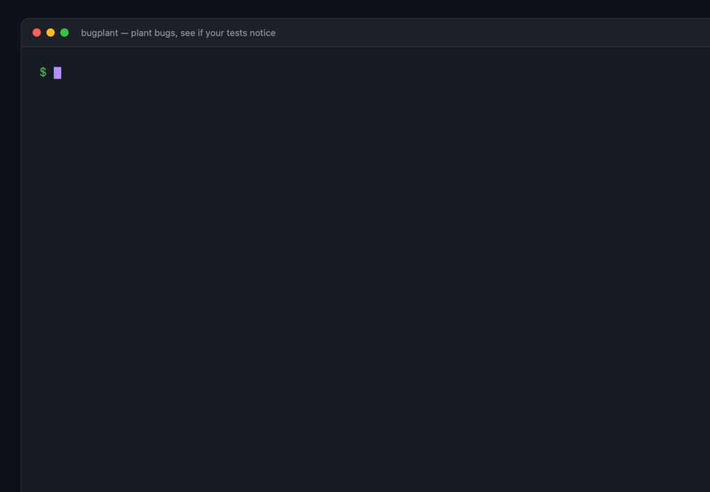
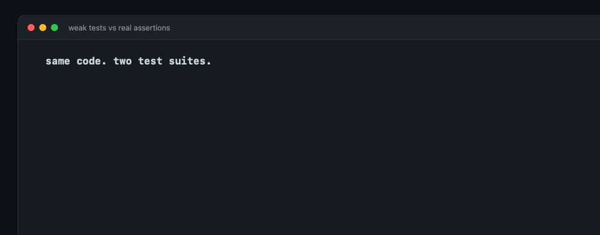

# bugplant

**Plant bugs in the code your agent just wrote. Your tests should kill them.**

[](https://github.com/AdilSiddiquiHQ/bugplant/actions/workflows/ci.yml)
[](./LICENSE)
[](https://nodejs.org)
[](#zero-runtime-dependencies)
[](https://github.com/AdilSiddiquiHQ/bugplant/stargazers)
[](https://github.com/AdilSiddiquiHQ/bugplant/commits)
[](#what-it-does-not-do)
[](./CONTRIBUTING.md)



`bugplant` takes the lines you changed, plants a bug in each of a sample of them, runs your
tests, and tells you how many bugs your tests noticed.

It is one number: **killed / planted**. No dashboards, no server, no account, no LLM.

```bash
npx bugplant --since origin/main
```

---

## The problem

A coding agent can write the code and the tests in the same breath. The tests pass. Nothing is
proven: the same agent that wrote the bug wrote the assertion that is supposed to catch it.

This is not a hypothesis any more. It is the most repeated complaint about agents in 2026:

- [The Test the Agent Wrote That Tests Nothing](https://tianpan.co/blog/2026/05/17/test-agent-wrote-that-tests-nothing)
- [How to Stop Letting AI Agents Fake Their Own Tests](https://www.freecodecamp.org/news/how-to-stop-letting-ai-agents-fake-their-own-tests/)
- [AI Generated Tests Are Passing And Still Lying To You](https://dev.to/thebitforge/ai-generated-tests-are-passing-and-still-lying-to-you-46fm)
- [Are Coding Agents Generating Over-Mocked Tests?](https://arxiv.org/html/2602.00409v1) (arXiv)

Everyone agrees the problem is real. Almost nobody measures it, because the measurement is
expensive: you have to break the code and see whether the suite notices.

That is the entire job of this tool. It breaks the code **for you**, on the lines you actually
changed, and reports what happened.

## What it does

```
your diff  ->  sample mutation points  ->  plant one bug at a time
           ->  run your tests          ->  kill or survive  ->  one score
```

A **killed** bug means your suite noticed. A **survivor** means you shipped code with no test
that would fail if that code were wrong.

```bash
npx bugplant                      # mutate lines added since origin/main
npx bugplant --all                # audit the whole tree
npx bugplant --dry-run            # see what would be planted, run nothing
npx bugplant --json | jq .score   # 0.444
```

No install. No config file required. No account. It reads `git diff`, so it works in any
repository and in CI.

## What the number means

| Outcome | Meaning |
|---|---|
| **killed** | The suite failed when the bug was planted. The tests constrain this line. |
| **survived** | The suite passed with the bug in place. Nothing you run would have caught it. |
| **discarded** | The mutation did not produce a loadable file, so it is not evidence either way. Never counted in the score. |
| **timeout** | Counted as killed, and labelled: the suite noticed *something*. |

`score = killed / (killed + survived)`. Discarded and timed-out runs are reported separately so
the headline number can not be inflated by a broken mutant.

## The example, measured

The repository ships a deliberately weak test suite in [`examples/shop`](examples/shop). This is
the real output, produced by `npm run demo` and asserted by the test suite:

<!-- demo:start -->
```text
  bugplant 0.1.0                            seed 1

  base     main
  changed  1 source file, 8 added lines
  planted  9 bugs
  tests    node --test · 1 related test file

  killed     ██████████░░░░░░░░░░░░  44%   4
  survived   ■■■■■■■■■■              5

  SURVIVORS — bugs your tests did not notice

  src/cart.js:4                     10 -> 9         const MIN_ORDER = 10;
  src/cart.js:12                    === -> !==      if (code === 'SAVE20') return total * 0.8;
  src/cart.js:12                    'SAVE20' -> ''  if (code === 'SAVE20') return total * 0.8;
  src/cart.js:12                    * -> /          if (code === 'SAVE20') return total * 0.8;
  src/cart.js:23                    < -> <=         if (base < MIN_ORDER) return base;

  score 44%  (4/9)
```
<!-- demo:end -->

Every survivor is a real defect. `if (code === 'SAVE20')` could be inverted, the coupon string
could be emptied, or the discount could be divided instead of multiplied — and the whole suite
still goes green, because no test ever applies the `SAVE20` coupon.

The same source with assertions that constrain behaviour
([`examples/shop-strict`](examples/shop-strict)) scores **92%**, and still leaves one survivor:
`MIN_ORDER = 10` could become `9`, because no test uses an order between 9 and 10.



That second survivor is the honest part. A good suite is not a perfect suite, and this tool
reports the difference instead of rounding it away.

## Why not just use Stryker?

Because they answer different questions, and you should use both.

| | Stryker | bugplant |
|---|---|---|
| Scope | whole repository, or configured files | **only the lines in your diff** |
| Default run | every mutant it can generate | **12 mutants, sampled, seeded** |
| Output | full report, dashboard, HTML | **one score and the survivors** |
| Setup | config, plugins, runner integration | **none** |
| Best at | deep analysis of a mature suite | **"is the test in this PR real?"** |

If you want exhaustive mutation analysis, use [Stryker](https://stryker-mutator.io). It is mature
and does far more than this. If you want a 60-second answer about the change in front of you,
that is what `bugplant` is for.

## How it works

1. **Diff.** `git diff -U0 <base>` gives the added line ranges. Only those lines are eligible.
2. **Tokenize.** A small JS/TS tokenizer finds real code and skips strings, comments, template
   literals and regular expressions — so nothing is "mutated" inside a comment.
3. **Plant.** Each candidate becomes one deliberate bug (see the operators below).
4. **Select tests.** A reverse import graph maps the changed file to the test files that can
   observe it. If the graph can not tell, it runs everything and says so.
5. **Run, restore, repeat.** One test run per bug. The original file is restored in a `finally`
   block, and on `SIGINT`/`SIGTERM` as well.

The baseline suite must be green before anything is scored. A red suite can not tell you whether
a bug was noticed, so `bugplant` refuses to guess and exits `2`.

## What gets planted

Six families, all of them bugs a reviewer would call a bug:

| Family | Examples |
|---|---|
| relational | `<` → `<=`, `>=` → `>`, `===` → `!==`, `!=` → `==` |
| arithmetic | `+` → `-`, `*` → `/`, `%` → `*` |
| logical | `&&` → `\|\|`, `\|\|` → `&&` |
| boolean | `true` → `false` |
| literal | `10` → `9`, `0` → `1`, `'SAVE20'` → `''` |
| increment | `++` → `--` |

Floats and bigints are skipped rather than guessed at. Template literals are skipped entirely.
Strings are replaced with the empty string of the same quote style.

## Test selection

For each mutated file, `bugplant` walks the reverse import graph and runs only the test files that
can reach it. That is what makes a 60-second run possible on a real repository.

If any changed file has no resolvable test path, the run falls back to the full suite for that
file and the header stops claiming a test count (`selectedTests: null` in JSON). It never silently
runs nothing: an unselected test would produce a fake survivor, which is worse than a slow run.

## Determinism

Sampling is seeded. The seed is printed on every run and included in JSON:

```bash
npx bugplant --seed 7      # same diff + same seed = same nine bugs
```

A CI run that fails today will fail identically tomorrow, which is the minimum requirement for a
gate you can trust.

## CI

```yaml
name: bugplant
on: pull_request

jobs:
  mutation:
    runs-on: ubuntu-latest
    steps:
      - uses: actions/checkout@v4
        with:
          fetch-depth: 0
      - uses: AdilSiddiquiHQ/bugplant@v0.1.0
        with:
          since: origin/${{ github.base_ref }}
          max: 12
          min-score: 60
```

Or without the Action:

```bash
npx bugplant --since "origin/$GITHUB_BASE_REF" --min-score 60
```

| Exit code | Meaning |
|---|---|
| `0` | Score is at or above `--min-score` (default `0`) |
| `1` | Score is below `--min-score` |
| `2` | Could not run: no base ref, red baseline, bad config |

Start with `min-score: 0` and watch the number for a week. A threshold you have not measured is a
threshold you will disable.

## JSON

```json
{
  "version": "0.1.0",
  "base": "origin/main",
  "seed": 1,
  "testCommand": "node --test",
  "selectedTests": 1,
  "sourceFiles": ["src/cart.js"],
  "addedLines": 8,
  "killed": 4,
  "survived": 5,
  "invalid": 0,
  "score": 0.4444444444444444,
  "mutants": [
    {
      "file": "src/cart.js",
      "line": 4,
      "family": "literal",
      "from": "10",
      "to": "9",
      "snippet": "const MIN_ORDER = 10;",
      "status": "survived",
      "ms": 412
    }
  ]
}
```

## Configuration

Optional, and never required:

```json
{
  "testCommand": "node --test",
  "maxMutants": 12,
  "timeoutMs": 30000,
  "minScore": 60,
  "ignore": ["examples/"]
}
```

`bugplant --init` writes a starter `.bugplant.json` and refuses to overwrite an existing one.
Command-line flags always win over the file.

## Zero runtime dependencies

`package.json` has no `dependencies` and no `devDependencies`. A test fails the build if either
appears, so the badge can not quietly become a lie.

What that buys you: `npx bugplant` downloads one small package, makes no network calls, sends no
telemetry, and runs your tests as a child process on your machine.

## What it does not do

Stated plainly, because a measurement tool that oversells itself is worse than no measurement:

1. **It is token-level, not AST-level.** It can plant a mutant that is syntactically invalid;
   those are detected and reported as `discarded`, never as killed.
2. **It samples.** Twelve bugs is a sample, not a proof. Raise `--max` or use Stryker for depth.
3. **It does not judge your tests.** It reports whether they killed a specific bug. A survived
   mutant in dead code is noise; read the snippets.
4. **Source only, JS/TS only.** Test files are never mutated.
5. **Equivalent mutants exist.** `10 → 9` behind an unreachable branch is not a real gap. The
   tool can not prove equivalence, so it shows you the line and lets you decide.
6. **Import-graph selection, not coverage.** Dynamic imports that the graph can not resolve fall
   back to the full suite.
7. **No live regions, no flaky-test handling, no reruns.** A flaky suite produces a flaky score;
   fix the suite first.

## FAQ

**Does it run my tests once per bug?**
Yes. `maxMutants × suite time` is the cost, which is why the default is 12 and the scope is the
diff.

**Does it work with Jest or Vitest?**
Yes. The default appends the selected test paths to your command. Use `--test-command "npx vitest run {tests}"`
if your runner needs a different shape.

**Why is my score 0%?**
Because your tests assert types, snapshots of the happy path, or mocks. That is the finding.

**Why is my score 100%?**
Because the sampled lines are genuinely constrained, or because they are trivial. The survivors
section is the interesting part of every report.

**Will it modify my working tree?**
Only for the duration of one test run, and it restores from memory in a `finally` block and on
interrupt. Commit or stash before a large `--all` run anyway.

**Why not coverage?**
Coverage says a line ran. It does not say a test would fail if the line were wrong. Those are
different questions, and only one of them is about trust.

## Development

```bash
npm test           # unit + end-to-end + README transcript check
npm run demo       # the measured example above
npm run gifs       # regenerate assets (macOS: Quick Look + ffmpeg)
npm run check      # invariants that must never regress
```

The test suite includes the README: the transcript above is regenerated and compared
byte-for-byte, so the documentation can not drift from the tool.

## License

MIT. See [LICENSE](./LICENSE).
